# Agente Gestor y Co-Piloto de Diseño Normativo de PCB (`designing-pcb-normative` v2.0)

> **Desarrollado por S&D MMCALL para la comunidad.**  
> Esta Skill transforma al agente en un **Ingeniero Co-Piloto de Hardware, Diseñador Normativo (IPC / IEC / J-STD / ANSI) y Gestor Completo de Abastecimiento (EasyEDA/LCSC + AliExpress + Alibaba)**, orquestando el conector MCP **[`easyeda-mcp-pro`](https://github.com/oaslananka/easyeda-mcp-pro)** (autor: `oaslananka`, licencia `AGPL-3.0-only`).

## 1. Principios Fundamentales

1. **Entender al usuario antes de diseñar:** Nunca asuma cómo se alimentará, soldará o comprará una placa. Ejecute siempre la **Fase 0** para alinear el diseño con el presupuesto, método de armado (soldadura manual vs. PCBA) y canal de compra del usuario.
2. **Memoria viva del proyecto:** Mantenga actualizados los archivos `HARDWARE-SPEC.md` y `BOM-SOURCING.md` en el proyecto del usuario usando las plantillas de la carpeta `templates/`.
3. **Diseñar sin calcular ni verificar la norma viola la física del circuito:** Nunca adivine anchos de pista, distancias de aislamiento, valores de desacoplo ni geometrías de ruteo.
4. **Modo Co-Piloto Seguro:** En EasyEDA Pro, use siempre transacciones reversibles (`begin_transaction` $\rightarrow$ captura visual $\rightarrow$ `commit_transaction`) y nunca exporte Gerbers sin verificar cero errores en ERC y DRC.

---

## 2. Contrato Operativo de 6 Fases (Flujo Obligatorio)

Ejecute estas fases en orden. Antes de iniciar cada fase, lea el manual normativo correspondiente en `references/`.

```dot
digraph pcb_normative_v2_flow {
    rankdir=LR;
    node [shape=box];
    F0 [label="Fase 0\nEntrevista, Contexto\ny HARDWARE-SPEC.md\n(Leer Manual 00)"];
    F1 [label="Fase 1\nClase IPC y Bloques\nPrácticos del Circuito\n(Leer Manual 05)"];
    F2 [label="Fase 2\nEsquemático, PDN y ESD\n(Leer Manual 01)"];
    F3 [label="Fase 3\nSourcing (LCSC/AliExpress/\nAlibaba), Térmica y HV\n(Leer Manuales 02 y 06)"];
    F4 [label="Fase 4\nPlanos GND, SI y Ruteo\n(Leer Manual 03)"];
    F5 [label="Fase 5\nDFM, IPC-A-610J, DRC\ny Cotización Final\n(Leer Manuales 04 y 06)"];
    F0 -> F1 -> F2 -> F3 -> F4 -> F5;
}
```

### Fase 0: Descubrimiento, Comprensión del Usuario y Memoria del Proyecto
1. **Lea obligatoriamente:** [references/00-entrevista-y-contexto-proyecto.md](references/00-entrevista-y-contexto-proyecto.md).
2. **Si ya existe un proyecto abierto en EasyEDA Pro:** Inspecciónelo primero sin hacer preguntas redundantes ejecutando `easyeda_health_check`, `easyeda_project_open`, `easyeda_schematic_components`, `easyeda_schematic_nets` y `easyeda_canvas_capture`.
3. **Acuerde con el usuario los 4 pilares del proyecto (1 o 2 preguntas claras a la vez):**
   * **A. Objetivo y ambiente:** Sensores/actuadores requeridos y entorno (define Clase 2 o Clase 3 de **IPC-6012** y grado de polución **IEC 60664-1**).
   * **B. Fuente de alimentación:** USB-C, batería LiPo/18650, $12\text{–}24\,\text{V}$ DC o $110\text{–}230\,\text{V}$ AC.
   * **C. Método de soldadura:**
     * *Soldadura manual en banco:* Use **IPC-7351B Nivel A** y paquetes cómodos (`0805`, `0603`, `SOIC`, módulos THT/castellados).
     * *Ensamblaje automático PCBA:* Use **IPC-7351B Nivel B** y paquetes compactos (`0402`, `QFN`) priorizando *Basic Parts*.
   * **D. Canal de compra de componentes (*Sourcing*):** Directo en **EasyEDA Pro / LCSC / JLCPCB**, compra independiente en **AliExpress / Alibaba**, o **Híbrido**.
4. **Genere la memoria del proyecto:** Cree o actualice `HARDWARE-SPEC.md` usando [templates/HARDWARE-SPEC.template.md](templates/HARDWARE-SPEC.template.md).

### Fase 1: Formulación de Bloques Electrónicos Prácticos y Clase IPC
1. **Lea obligatoriamente:** [references/05-bloques-electronicos-practicos.md](references/05-bloques-electronicos-practicos.md).
2. **Formule los bloques del circuito con valores reales:**
   * **USB-C ($5\,\text{V}$ UFP):** Dos resistencias independientes de **$5.1\,\text{k}\Omega$ a GND** en `CC1` y `CC2` + TVS `USBLC6-2SC6`.
   * **Reguladores (LDO vs. Buck):** Evalúe $P_{\text{loss}} = (V_{\text{in}} - V_{\text{out}}) \cdot I_{\text{load}}$. Si $P_{\text{loss}} > 0.5\,\text{W}$, use convertidor Buck minimizando el *Hot Loop* y aislando el nodo `FB` del nodo conmutado `SW`.
   * **Baterías Li-Ion/LiPo:** Conmutación automática *Power Path* (MOSFET canal P + Schottky) y divisor ADC con capacitor filtro de $100\,\text{nF}$.
   * **Buses I2C y RS-485:** Cálculo de *Pull-Ups* I2C ($2.2\,\text{k}\Omega\text{–}4.7\,\text{k}\Omega$) y terminación RS-485 de $120\,\Omega$ + TVS asimétrico `SM712`.
   * **Relés y cargas inductivas:** Diodo *Flyback* antiparalelo + MOSFET *Logic-Level* con resistencia de compuerta en serie ($R_g = 22\text{–}100\,\Omega$) y descarga a tierra ($R_{gs} = 10\text{–}100\,\text{k}\Omega$).

### Fase 2: Esquemático Normativo, Red de Potencia (PDN), Terminaciones y Protección ESD
1. **Lea obligatoriamente:** [references/01-esquematico-pdn-esd.md](references/01-esquematico-pdn-esd.md).
2. **Calcule y aplique:**
   * **MCU (AN2586 / AN2867):** $100\,\text{nF}\text{–}1\,\mu\text{F}$ a $< 2\,\text{mm}$ de cada pin $V_{DD}$ y cristal aislado sin trazas digitales debajo.
   * **Impedancia objetivo PDN:** $Z_{\text{target}} = \frac{\Delta V_{\text{allowed}}}{\Delta I_{\text{transient}}}$ y desacoplo en **3 décadas** ($10\,\mu\text{F} + 100\,\text{nF} + 10\,\text{nF}$) respetando $f_{\text{SRF}} = \frac{1}{2\pi\sqrt{\text{ESL}\cdot C}}$.
   * **Terminación serie en relojes/SPI rápidos:** $R_s = Z_{\text{trace}} - Z_{\text{source}}$ colocada en el pin transmisor para lograr $\Gamma = 0$.
   * **Inmunidad ESD (IEC 61000-4-2):** Diodos TVS ultrarrápidos (respuesta $< 0.8\,\text{ns}$, hasta $30\,\text{A}$ en Nivel 4 / $\pm 8\,\text{kV}$ contacto) en cada conector externo.
3. **Ejecución en Modo Co-Piloto MCP:** Use `easyeda_schematic_plan_safe_region`, `easyeda_project_begin_transaction`, `easyeda_workflow_power_rail`, `easyeda_workflow_decouple_ic`, `easyeda_schematic_check_collisions`, `easyeda_schematic_capture_full_page`, `easyeda_project_commit_transaction`, `easyeda_semantic_erc_auto` y `easyeda_erc_run`.

### Fase 3: Gestor de Abastecimiento (LCSC / AliExpress / Alibaba), Térmica y Aislamiento
1. **Lea obligatoriamente:** [references/06-copiloto-easyeda-sourcing-global.md](references/06-copiloto-easyeda-sourcing-global.md) y [references/02-termica-aislamiento-materiales.md](references/02-termica-aislamiento-materiales.md).
2. **Audite y seleccione los componentes reales (complete `BOM-SOURCING.md` usando [templates/BOM-SOURCING.template.md](templates/BOM-SOURCING.template.md)):**
   * **Si compra en EasyEDA Pro / LCSC / JLCPCB:** Ejecute `easyeda_catalog_verify_device` y `easyeda_bom_sourcing`. Priorice **Basic Parts** para eliminar cargos de cambio de carrete y confirme stock $> 0$.
   * **Si compra en AliExpress (prototipos/módulos/conectores):** Busque con `search_web` (`domain: "aliexpress.com"`) o `browser`. Exija tienda con **$\ge 95\%$ positivo**, antigüedad $> 2$ años, producto **$\ge 4.7\star$**, calcule costo con envío incluido (*Landed Cost*) y alerte de **riesgo de chip falso/remarcado** si un IC cuesta $< 40\%$ de su valor en LCSC.
   * **Si compra en Alibaba (lotes/baterías/gabinetes/OEM):** Busque con `search_web` (`domain: "alibaba.com"`) o `browser`. Exija sello **`Verified Supplier`** (SGS/TÜV), **`Trade Assurance`**, entrega a tiempo $\ge 95\%$, reporte MOQ/escalas de precio y verifique medidas del plano mecánico antes de cerrar el *footprint* en EasyEDA Pro.
3. **Calcule parámetros térmicos, de alta tensión y sustrato:**
   * **Ancho de pista por corriente (IPC-2221 / IPC-2152):** $I = k \cdot \Delta T^{0.44} \cdot A_c^{0.725}$ (ej. $5\,\text{A}$ a $1\,\text{oz}$, $\Delta T=10\,^\circ\text{C} \rightarrow$ **$2.770\,\text{mm}$ externa** / **$7.190\,\text{mm}$ interna**) y corrección **IPC-2152**.
   * **Vías térmicas:** $R_{\text{th}} = \frac{L}{k \cdot A}$ ($k = 385\,\text{W/m}\cdot\text{K}$), perforación $0.2\text{–}0.3\,\text{mm}$ y paso $0.5\,\text{mm}$.
   * **Clearance y Creepage (IPC-2221C Tabla 6-1, IEC 60664-1, IEC 62368-1):** Evalúe con **$V_{\text{peak}}$** y columna **B2** en capas externas (la máscara antisoldante normal no es recubrimiento permanente B4). Para $230\,\text{V}_{\text{RMS}}$ ($325\,\text{V}_{\text{peak}}$), exija mínimo **$2.50\,\text{mm}$** + **ranura fresada (*milled slot* $> 1.0\,\text{mm}$)** si falta distancia superficial en FR-4 (**Grupo IIIa**).
   * **Laminado base (IPC-4101):** Especifique **`IPC-4101/126`** ($T_g \ge 150\text{–}170\,^\circ\text{C}$, $T_d \ge 340\,^\circ\text{C}$) para reflujo sin plomo SAC305 o **`IPC-4101/129`** libre de halógenos.

### Fase 4: Planos GND Continuos, Integridad de Señal (SI) y Ruteo
1. **Lea obligatoriamente:** [references/03-integridad-senal-gnd-ruteo.md](references/03-integridad-senal-gnd-ruteo.md).
2. **Aplique en el PCB:**
   * **Continuidad absoluta de GND:** Plano GND sólido debajo de toda señal rápida. **Prohibido cruzar cortes de plano (*split planes*)**. Coloque vías de retorno a GND junto a cada vía de cambio de capa y vías dobles en capacitores de desacoplo.
   * **Impedancia controlada (IPC-2141A) y Diafonía:** Geometría Microstrip/Stripline ($W/H \le 7.5$), pares diferenciales ($85\text{–}100\,\Omega$, *skew* $\le 5\,\text{mils}$), regla **$3W$** (general) y **$5W$** (relojes/críticas).
   * **HDI y Flex (IPC-2226 / IPC-2223E):** Microvías escalonadas (*staggered*) en BGA $\le 0.5\,\text{mm}$; trazado a $90^\circ$ y radios de $6\times\text{–}150\times$ en flexibles.
3. **Herramientas MCP:** `easyeda_pcb_floorplan`, `easyeda_pcb_place_component_group`, `easyeda_pcb_add_zone`, `easyeda_pcb_route_path_plan`, `easyeda_pcb_add_track`, `easyeda_pcb_add_via`, `easyeda_pcb_rebuild_copper` y `easyeda_canvas_capture`.

### Fase 5: Verificación DFM, Ensamblaje, Cotización y Exportación Final
1. **Lea obligatoriamente:** [references/04-dfm-ensamblaje-easyeda-mcp.md](references/04-dfm-ensamblaje-easyeda-mcp.md).
2. **Audite:**
   * **DFM Rígido (IPC-6012):** Anillo anular intacto en Clase 3 ($\ge 1\,\text{mil}$ interno, $\ge 2\,\text{mils}$ externo), cobre en barril PTH ($\ge 20\,\mu\text{m}$ Clase 2, $\ge 25\,\mu\text{m}$ Clase 3 sin vacíos), distancia taladro-cobre $\ge 8\,\text{mils}$ ($0.20\,\text{mm}$) y relación de aspecto $\le 10:1$ en PTH.
   * **Ensamblaje (IPC-A-610J / J-STD-001J / IPC-7095):** Llenado THT $\ge 75\%$, vacíos BGA $\le 25\%$, cero *champagne voids* en Clase 3, contaminación iónica $\le 1.56\,\mu\text{g/cm}^2$ NaCl y control EPA **ANSI/ESD S20.20** ($\le 35\,\text{M}\Omega$).
3. **Secuencia obligatoria antes de exportar:** Ejecute `easyeda_erc_run`, `easyeda_drc_run`, `easyeda_pcb_constraint_check`, `easyeda_pcb_route_geometry_review`, `easyeda_engineering_review`, `easyeda_bom_quality_report` y `easyeda_jlcpcb_quote_workflow`. Solo con **cero errores DRC/ERC** ejecute `easyeda_production_qa_artifacts` o `easyeda_export_gerbers`.

---

## 3. Tabla contra Racionalizaciones (Prohibido Saltar Reglas bajo Presión)

| Excusa del Usuario o del Agente | Realidad Física y Normativa (Respuesta Obligatoria) |
| :--- | :--- |
| *"Estoy apurado, dime un valor rápido sin calcular"* | Los cálculos toman 10 segundos y evitan que la placa se queme o falle por EMI. Entregue el valor exacto calculado con su norma IPC/IEC. |
| *"La máscara antisoldante protege los 230 V AC"* | Falso. Según **IPC-2221C**, la máscara antisoldante normal no es recubrimiento permanente (B4). Use la columna **B2** ($2.50\,\text{mm}$ para $325\,\text{V}_{\text{peak}}$) y **IEC 60664-1**. |
| *"Encontré este chip STM32 a \$0.30 en una tienda nueva de AliExpress"* | Alto riesgo de chip remarcado/falso ($< 40\%$ del valor oficial). Compre los circuitos integrados críticos en **LCSC** y use **AliExpress/Alibaba** solo en tiendas verificadas ($\ge 95\%$, $\ge 4.7\star$, *Verified Supplier*) para módulos, conectores y carcasas. |
| *"Exporta los Gerbers directo con `easyeda_export_gerbers`"* | Prohibido exportar sin ejecutar antes `easyeda_erc_run`, `easyeda_drc_run`, `easyeda_pcb_route_geometry_review` y `easyeda_engineering_review`. |

---

## 4. Banderas Rojas — DETÉNGASE y Corrija Inmediatamente

- Empezar a diseñar sin preguntar o verificar cómo se alimentará, soldará y comprará la placa (omitir Fase 0).
- Colocar un componente comprado en AliExpress o Alibaba sin verificar que sus medidas físicas coincidan con el *footprint* en EasyEDA Pro.
- Evaluar aislamiento eléctrico en AC usando tensión RMS en lugar de tensión pico ($V_{\text{peak}}$).
- Omitir las dos resistencias independientes de $5.1\,\text{k}\Omega$ en `CC1` y `CC2` en conectores USB-C.
- Trazar relojes o buses rápidos cruzando cortes en el plano de retorno GND.
