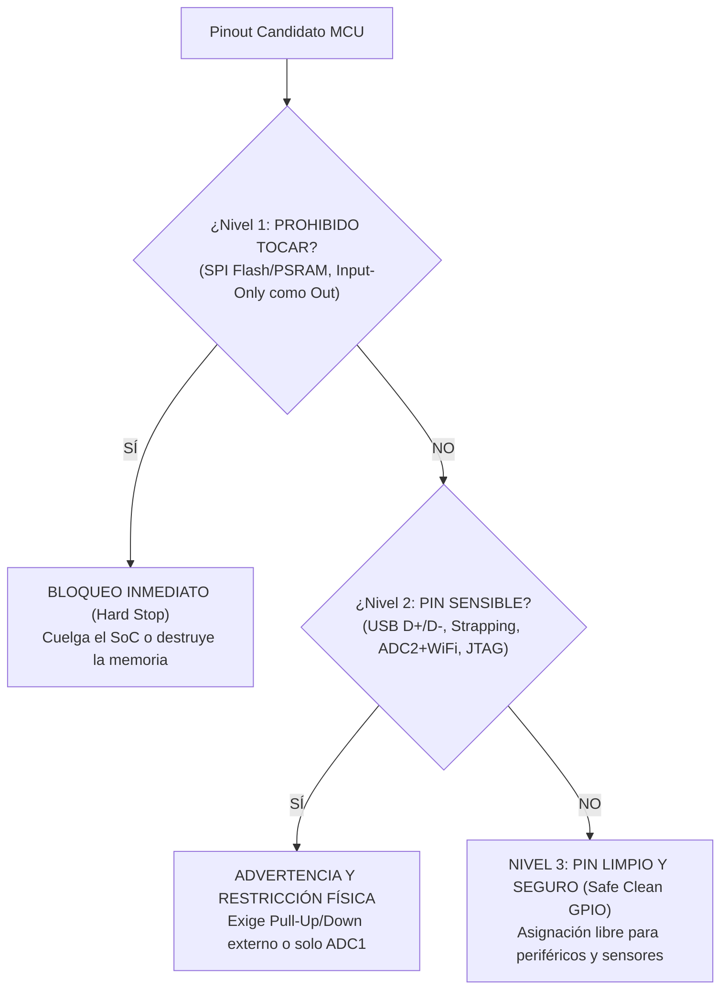

# Manual 08: Co-Diseño Hardware–Firmware de Microcontroladores, Pines Trampa y Antenas RF

> **Estándares aplicados:** Guías de Diseño de Hardware Espressif (ESP32/S3/C3/C5/C6), STMicroelectronics (AN2586/AN4488), Raspberry Pi (Hardware Design with RP2040/RP2350), Microchip AVR042, Diseño de Antenas en PCB ($2.4\,\text{GHz}$ / $5\,\text{GHz}$ / Sub-GHz), ISO 24495-1 e ISO/IEC 82079-1.  
> **Autor:** S&D MMCALL — Proyecto Comunitario `AGENT-DESIGN-PCB`.

---

## 1. Reglas Universales de Co-Diseño Hardware–Firmware

> [!CAUTION]
> **Placas que no entran en modo programación o activan salidas al encender:** Durante los primeros milisegundos del encendido, todo microcontrolador muestrea sus **pines de arranque (*Strapping / Boot Pins*)** y mantiene el resto de sus GPIO en alta impedancia o con *pull-ups* débiles internos. Si conecta un relé, MOSFET o sensor que fuerce un nivel lógico indebido en un pin de *strapping*, el chip jamás arrancará.

### Procedimiento Obligatorio antes de Cerrar el Esquemático del MCU

1. **Verifique la Matriz de 3 Niveles de Pines de la familia elegida** (ver Sección 2 y ejecutar `pcb_validate_mcu_pinout`).
2. **Coloque siempre un cabezal de programación y depuración nativo** (SWD, JTAG, ISP o USB Serial/JTAG) accesible con puntos de prueba.
3. **Asegure un estado de reposo seguro (*Fail-Safe Default*) en todos los actuadores:** Coloque resistencias *Pull-Down* ($10\,\text{k}\Omega\text{–}100\,\text{k}\Omega$) en las compuertas de MOSFETs y entradas de *drivers* de motor/relé para que permanezcan apagados mientras el MCU inicializa su firmware.

---

## 2. Matriz de Seguridad de Pines de 3 Niveles por Familia

Antes de asignar cualquier pista o pin en el esquemático, clasifique los pines según esta matriz de 3 niveles:

### 2.1. Tabla Maestra de Familias Espressif y SoMs Integrados

| Familia MCU / Módulo | Nivel 1: PROHIBIDO TOCAR (Flash / PSRAM / Internos) | Nivel 2: PINES SENSIBLES (Strapping / USB / ADC2 / JTAG) | Nivel 3: PINES LIMPIOS RECOMENDADOS |
| :--- | :--- | :--- | :--- |
| **ESP32 Clásico** (`WROOM-32`) | `GPIO6`, `GPIO7`, `GPIO8`, `GPIO9`, `GPIO10`, `GPIO11` *(Bus SPI Flash integrado)*. En `WROVER`: suma `GPIO16`, `GPIO17` *(PSRAM)*. `GPIO34..39` **PROHIBIDO como Salida** (Input-Only). | **Strapping:** `GPIO0` (Boot), `GPIO2` (LOW al flashear), `GPIO5`, `GPIO12` (MTDI: ¡si está HIGH al boot fuerza VDD_SDIO=1.8V y quema/bloquea Flash 3.3V!), `GPIO15`. **ADC2 (Bloqueado con Wi-Fi):** `GPIO0`, `2`, `4`, `12`, `13`, `14`, `15`, `25`, `26`, `27`. **Input-Only:** `GPIO34`, `35`, `36`, `39` (sin pull-up/down interno). | `GPIO4`, `GPIO13`, `GPIO14`, `GPIO18`, `GPIO19`, `GPIO21`, `GPIO22`, `GPIO23`, `GPIO25`, `GPIO26`, `GPIO27`, `GPIO32`, `GPIO33`. |
| **ESP32-S3** (`WROOM-1 / Mini`) | `GPIO26`, `GPIO27`, `GPIO28`, `GPIO29`, `GPIO30`, `GPIO31`, `GPIO32` *(Bus SPI Flash Quad)*. **Si usa Octal Flash/PSRAM:** suma `GPIO33`, `GPIO34`, `GPIO35`, `GPIO36`, `GPIO37` *(NO TOCAR)*. | **USB Nativo:** `GPIO19 (D-)`, `GPIO20 (D+)` (Serial/JTAG). **Strapping:** `GPIO0`, `GPIO3`, `GPIO45` (VDD_SPI), `GPIO46` (debe estar LOW al arrancar). **ADC2 (Bloqueado con Wi-Fi):** `GPIO11..GPIO20`. | `GPIO1`, `GPIO2`, `GPIO4`, `GPIO5`, `GPIO6`, `GPIO7`, `GPIO8`, `GPIO9`, `GPIO10`, `GPIO11`, `GPIO12`, `GPIO13`, `GPIO17`, `GPIO18`, `GPIO21`, `GPIO38..GPIO42`. |
| **ESP32-C3** (`Mini-1`) | `GPIO12`, `GPIO13`, `GPIO14`, `GPIO15`, `GPIO16`, `GPIO17` *(Flash SPI)*. | **USB Nativo:** `GPIO18 (D-)`, `GPIO19 (D+)`. **Strapping:** `GPIO2`, `GPIO8` (¡CRÍTICO: pull-up 10k obligatorio para descarga!), `GPIO9` (Boot). **ADC2:** `GPIO5`. | `GPIO0`, `GPIO1`, `GPIO3`, `GPIO4`, `GPIO5`, `GPIO6`, `GPIO7`, `GPIO10`. |
| **ESP32-C6** (`XIAO C6`) | `GPIO24`, `GPIO25`, `GPIO26`, `GPIO27`, `GPIO28`, `GPIO29`, `GPIO30` *(Flash SPI)*. | **USB Nativo:** `GPIO12 (D-)`, `GPIO13 (D+)`. **Strapping:** `GPIO4`, `GPIO5`, `GPIO8`, `GPIO9` (Boot), `GPIO15`. **Deep Sleep Wake:** Solo `GPIO0..GPIO7` son LP-IO (ext1). | `GPIO0`, `GPIO1`, `GPIO2`, `GPIO3`, `GPIO6`, `GPIO7`, `GPIO10`, `GPIO11`, `GPIO16..GPIO23`. |
| **ESP32-C5** (`XIAO C5` Wi-Fi 6 2.4/5GHz) | `GPIO15`, `GPIO16`, `GPIO17`, `GPIO18`, `GPIO20`, `GPIO21`, `GPIO22` *(Flash SPI)*. **Pads JTAG inferiores:** `MTMS` (GPIO2), `MTDI` (GPIO3), `MTCK` (GPIO4), `MTDO` (GPIO5) prohibidos para wake/I2C. | **USB Nativo:** `GPIO13 (D-)`, `GPIO14 (D+)`. **Strapping:** `GPIO2`, `GPIO3`, `GPIO7` (`D3`), `GPIO25` (`D2`: ¡NO TIENE ADC!), `GPIO26..28`. **ADC1 en XIAO:** Solo `D0` (`GPIO1 = ADC1_CH0`) y `GPIO2..6`. | `D0` (`GPIO1` ADC1/LP), `D1` (`GPIO0` LP), `D4` (`GPIO23` SDA), `D5` (`GPIO24` SCL), `D6` (`GPIO11` TX), `D7` (`GPIO12` RX), `D8` (`GPIO8`), `D9` (`GPIO9`), `D10` (`GPIO10`). |
| **DPTechnics Walter** (`ESP32-S3` + Sequans Módem) | Todos los del ESP32-S3 Flash/PSRAM + **Pines internos módem Sequans GM02SP:** `GPIO14` y `GPIO45` (UART interno). Conectarlos rompe la comunicación celular. | Idem ESP32-S3 en pines expuestos al cabezal. | Pines libres del SoM documentados en su esquemático de integración. |

---

## 3. Otras Familias de Microcontroladores

### 3.1. STMicroelectronics: STM32 (F1 / F4 / G0 / L4 / H7)
1. **Pin `BOOT0`:** Conecte siempre una resistencia de **$10\,\text{k}\Omega$ desde `BOOT0` a `GND`** para arrancar desde la memoria Flash principal.
2. **Pin `NRST`:** Resistencia *Pull-Up* interna ($\approx 40\,\text{k}\Omega$) + **capacitor de $100\,\text{nF}$ a `GND`**.
3. **Aislamiento `VDDA` / `VSSA`:** Debe estar alimentado siempre. Filtre con perla de ferrita + $10\,\text{nF} + 1\,\mu\text{F}$ directos a `VSSA`.
4. **SWD Estándar (4/5 pines):** `3V3_REF`, `SWDIO`, `SWCLK`, `GND` y `NRST`.

### 3.2. Raspberry Pi (RP2040 / RP2350) y Microchip AVR (ATmega328P)
* **RP2040 / RP2350:**
  * Resistencias de terminación serie de **$27\,\Omega$** en `USB_DP` y `USB_DM` inmediatamente junto al chip.
  * Flash QSPI a menos de $5\,\text{mm}$ del chip, con $1\,\text{k}\Omega$ hacia botón `BOOTSEL`.
* **AVR (ATmega328P / Arduino Uno embebido):**
  * **¡Nunca conecte `AREF` directamente a `VCC` ($5\,\text{V}$)!** Conecte `AREF` únicamente a un capacitor de **$100\,\text{nF}$ hacia `GND`**.
  * Filtre `AVCC` con inductor de $10\,\mu\text{H}$ + $100\,\text{nF}$ a `GND`. Cabezal **ICSP de 6 pines** con $10\,\text{k}\Omega$ pull-up en `RESET`.

---

## 4. Arquitectura Ultra-Low-Power (ULP) Wi-Fi + Celular SIM

### 4.1. Dilema de Selección: ¿Placa Todo-en-Uno Comercial vs. Módulo SoM vs. Diseño Propio PCBA?

Para proyectos como `Sensor-Mini-V2` (gabinete interior $92\times 61\,\text{mm}$, PCB $86\times 54\,\text{mm}$, batería 18650, Emnify SIM, Wi-Fi y Deep Sleep $<30\,\mu\text{A}$):

| Criterio Técnico | Placa Comercial (LilyGO T-SIM7080G-S3) | SoM Certificado (DPTechnics Walter) | Diseño Propio desde Cero (XIAO ESP32-C5 + SMD SIM7080G + Nano-SIM) |
| :--- | :--- | :--- | :--- |
| **Dimensiones Físicas** | **$110 \times 32\,\text{mm}$ (INVIABLE)** — No cabe en el gabinete de $92 \times 61\,\text{mm}$. | **$55 \times 24.8\,\text{mm}$ (CABE)** — Entra en la placa carrier de $86 \times 54\,\text{mm}$. | **$86 \times 54\,\text{mm}$ Todo Integrado (GANADOR)** — Aprovecha el 100% del área y encaja perfecto en torretas. |
| **Wi-Fi** | 2.4 GHz (ESP32-S3) | 2.4 GHz (ESP32-S3) | **Dual-Band 2.4 GHz + 5 GHz Wi-Fi 6** (ESP32-C5) |
| **Corriente Deep Sleep** | **$360\,\mu\text{A} \text{–} 1.2\,\text{mA}$ (INACEPTABLE)** debido a PMIC AXP2101 y cargas parásitas. | **$9.5 \text{–} 9.8\,\mu\text{A}$ (EXCELENTE)** con módem Sequans GM02SP en PSM. | **$27.1\,\mu\text{A}$ TOTAL (EXCELENTE)**: XIAO C5 ($18\,\mu\text{A}$) + SIM7080G apagado por MOSFET ($0.0\,\mu\text{A}$) + SHTC3 ($0.3\,\mu\text{A}$) + LDO ($8.8\,\mu\text{A}$). |
| **Costo BOM Celular+SIM** | \$35 – \$42 USD | **\$55 – \$65 USD** (Muy costoso) | **~\$10.50 USD** en JLCPCB PCBA (\$8.50 SIM7080G + \$0.35 Nano-SIM + \$1.20 pasivos/MOSFET). |
| **Flexibilidad SIM** | Nano-SIM fijo | Nano-SIM fijo | **Doble Footprint:** Nano-SIM 4FF mecánico + huella paralela **MFF2 eSIM** para Emnify SMD. |
| **Veredicto Normativo** | **DESCARTADO** (no cabe y no es ULP). | **OPCIÓN PLUG-AND-PLAY** si el cliente acepta pagar \$60 USD por módulo para no certificar RF. | **GANADOR INDUSTRIAL ÓPTIMO** para producción en serie y bajo costo. |

### 4.2. Prevención Crítica de *Back-Powering* por UART en Diseños ULP

> [!CAUTION]
> **Alimentación parásita destructiva (*Phantom Back-Powering*):** Cuando el MCU corta la alimentación principal del módem celular mediante un interruptor de carga (MOSFET Canal P `AO3401A`), el módem queda con su pin `VBAT` en $0\,\text{V}$. Si el microcontrolador mantiene en ALTO ($3.3\,\text{V}$) sus pines `UART_TX`, `PWRKEY` o `RESET`, la corriente fluye a través de los **diodos de protección ESD internos** del módem hacia su riel de alimentación interno.
> - **Consecuencia 1:** El módem consume entre $2\,\text{mA}$ y $15\,\text{mA}$ continuos, agotando la batería en días e invalidando el Deep Sleep.
> - **Consecuencia 2:** Puede inducir *latch-up* destructivo en el módem al volver a encender la fuente principal.

#### Solución Obligatoria en Hardware y Firmware
1. **En Hardware:** Utilice un traslador de nivel con auto-detección y apagado en alta impedancia (**`TXS0102` / `TXB0102`**). Conecte el pin `VCCA` del traslador al pin de salida **`VDD_EXT` ($1.8\,\text{V}$)** del módem SIM7080G. Cuando el módem se apaga, `VDD_EXT` cae a $0\,\text{V}$, poniendo automáticamente todas las líneas UART hacia el módem en **Alta Impedancia (Hi-Z)**.
2. **En Firmware (Fallback si se usan transistores discretos):** Antes de ejecutar `digitalWrite(MODEM_EN_PIN, HIGH)` para cortar el MOSFET P, el microcontrolador debe reconfigurar por software `TX`, `PWRKEY` y `RESET` como `INPUT` o en nivel `LOW`.

---

## 5. Diseño de Antenas RF y Zonas de Exclusión de Cobre (*Keep-Out*)

> [!CAUTION]
> **Pérdida del $80\text{–}95\%$ del alcance inalámbrico por apantallamiento de cobre:** Si vierte plano de tierra (`GND`) o traza pistas debajo de la antena impresa de un módulo ESP32, desintonizará la antena y bloqueará la radiación electromagnética.

### 5.1. Reglas de Emplazamiento para Módulos con Antena en PCB (ESP32-WROOM / MINI / XIAO)
1. **Ubique la antena en el borde exterior de la placa:** La sección de la antena impresa debe **sobresalir fuera del contorno del sustrato principal** o quedar pegada al borde sin pistas que la rodeen.
2. **Zona *Keep-Out* absoluta:**
   * Dibuje una región de prohibición (*Keep-Out / No Copper Pour*) en **TODAS las capas del PCB (Top, Internas y Bottom)** debajo y al frente de la antena.
   * Extienda dicha zona vacía al menos **$15\,\text{mm}$ hacia los lados**, libre de componentes, planos GND, vías, tornillos o paredes metálicas.

### 5.2. Reglas para Trazas de Radiofrecuencia ($50\,\Omega$) hacia Conector SMA / IPEX (U.FL)
1. **Coplanar Waveguide with Ground a $50\,\Omega$:** Pista corta y directa desde el pin `ANT` del módem al conector coaxial IPEX, calculada con `pcb_normative_impedance_si` contra el stackup JLCPCB real, flanqueada por plano GND cosido con vías cada $1.0\text{–}1.5\,\text{mm}$.
2. **Red de Adaptación en $\pi$ (*Pi-Matching*):** Incluya huellas `0402` (un elemento serie y dos a masa) para sintonía en laboratorio (inicialmente $0\,\Omega$ serie y derivaciones vacías).
3. **Plano de Referencia para LTE Band 28 ($700\,\text{MHz}$):** Las antenas celulares FPC o integradas exigen un plano de tierra continuo de al menos $60 \times 40\,\text{mm}$ para actuar como contra-antena dipolar eficiente.
