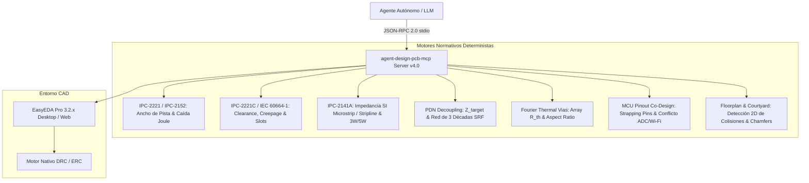

# Manual 12: Servidor MCP Normativo del Agente PCB y Acoplamiento con EasyEDA Pro

## 1. Propósito y Alcance

Este manual establece la especificación técnica, operativa y arquitectónica del servidor **`agent-design-pcb-mcp`** (v4.0), desarrollado por **S&D MMCALL** para la comunidad internacional de hardware y diseño electrónico.

El servidor opera como un motor de cómputo determinista y auditor normativo bajo el protocolo estándar **Model Context Protocol (MCP)** sobre entrada/salida estándar (`stdio` JSON-RPC 2.0). Su objetivo es proporcionar a los modelos de lenguaje (LLMs) y agentes autónomos capacidades matemáticas formales basadas en normas **IPC** e **IEC**, garantizando diseños de PCB libres de alucinaciones dimensionales o eléctricas antes de interactuar con el entorno CAD **EasyEDA Pro**.

---

## 2. Arquitectura del Servidor y Flujo Operativo



### Regla de Oro del Agente: Verificación Normativa Previa al Trazado
> [!IMPORTANT]
> Ningún agente autónomo debe colocar pistas, vías o polígonos de cobre en EasyEDA Pro sin antes haber verificado las dimensiones exactas mediante las herramientas normativas de este servidor MCP. Las decisiones de ruteo deben estar respaldadas por ecuaciones físicas y tablas normativas verificadas, nunca por estimaciones probabilísticas del LLM.

---

## 3. Catálogo Detallado de Herramientas MCP Nativas

### 3.1. `pcb_normative_trace_calculator`
* **Norma Aplicable:** IPC-2221, IPC-2152, Ley de Joule ($P = I^2 R$) y resistividad con coeficiente térmico del cobre ($\alpha_{\text{Cu}} = 0.00393\,/\text{°C}$).
* **Entradas:**
  * `current_a` (float, obligatorio): Corriente eficaz continua o pico en amperios.
  * `temp_rise_c` (float, por defecto `10.0`): Elevación admisible de temperatura sobre el ambiente.
  * `copper_oz` (float, por defecto `1.0`): Espesor de cobre (1 oz = 35 µm, 2 oz = 70 µm, 0.5 oz = 17.5 µm).
  * `layer` (string, `"external"` o `"internal"`): Capa externa (mayor convección) o interna.
  * `length_mm` (float, opcional): Longitud física de la pista para calcular caída óhmica de tensión ($\Delta V$) y disipación de calor ($P_{\text{loss}}$).
* **Salida Estructurada:**
  * `ipc_2221_width_mm`: Ancho normativo estricto IPC-2221.
  * `ipc_2152_plane_assisted_width_mm`: Ancho optimizado según IPC-2152 cuando la pista corre sobre un plano de masa continuo adyacente (reducción térmica de hasta un 25 %).
  * `electrical_thermal`: Resistencia de la pista a temperatura de operación ($R_{\text{warm}}$), caída de tensión en mV y potencia disipada en mW.

---

### 3.2. `pcb_normative_clearance_creepage`
* **Norma Aplicable:** IPC-2221C Tabla 6-1, IEC 60664-1, IEC 62368-1.
* **Entradas:**
  * `voltage_val` (float, obligatorio): Magnitud de la tensión.
  * `is_ac_rms` (boolean, obligatorio): Si es `true`, el servidor calcula automáticamente la tensión cresta o de pico ($V_{\text{peak}} = V_{\text{RMS}} \times \sqrt{2}$).
  * `location` (string): `"internal_B1"`, `"external_uncoated_B2"` (hasta 3050 m altitud), `"external_coated_B4"` (con máscara antisoldante permanente) o `"component_lead_A5"`.
  * `pollution_degree` (int, por defecto `2`): Grado de contaminación según IEC 60664-1 (1 = seco/sellado, 2 = entorno residencial/oficina con condensación ocasional, 3 = industrial pesado).
  * `cti_group` (string, por defecto `"IIIa"`): Grupo de índice de prueba de resistencia a la formación de caminos conductores (FR4 estándar pertenece a IIIa/IIIb, CTI 175–400).
* **Salida Estructurada:**
  * `evaluated_v_peak`: Tensión cresta de diseño.
  * `ipc_2221c_clearance_mm`: Distancia mínima de aislamiento por aire (*Clearance*).
  * `iec_60664_creepage_mm`: Distancia mínima de fuga superficial (*Creepage*).
  * `milled_slot_recommendation`: Indicación booleana de si se requiere una ranura pasante fresada (*Milled Slot*) y su ancho mínimo recomendado ($> 1.5\,\text{mm}$ para fresa estándar).

---

### 3.3. `pcb_normative_impedance_si`
* **Norma Aplicable:** IPC-2141A (Sección 3: Ecuaciones de Microstrip y Stripline de Señales Rápidas).
* **Entradas:**
  * `topology` (string): `"microstrip"` o `"stripline"`.
  * `trace_width_mm` (float): Ancho de la pista ruteada ($W$).
  * `dielectric_h_mm` (float): Altura del dieléctrico hasta el plano de referencia más cercano ($H$).
  * `copper_oz` (float, por defecto `1.0`): Espesor de cobre.
  * `er` (float, por defecto `4.4`): Constante dieléctrica relativa del sustrato (FR4 estándar $\approx 4.4$, Isola $\approx 3.8$, Rogers RO4350B $\approx 3.66$).
  * `driver_z_source_ohm` (float, por defecto `20.0`): Impedancia interna del pin emisor del MCU.
* **Salida Estructurada:**
  * `z0_characteristic_ohm`: Impedancia característica de la línea.
  * `ipc_2141a_formula_valid`: Validez geométrica del modelo ($0.1 < W/H < 3.0$).
  * `propagation_delay_ps_per_mm`: Retardo de propagación dieléctrico en picosegundos por milímetro.
  * `termination`: Resistencia serie de amortiguación recomendada ($R_s = Z_0 - Z_{\text{source}}$) y coeficiente de reflexión ($\Gamma$).
  * `crosstalk_and_gnd_rules`: Distancias de separación entre señales adyacentes para mitigar diafonía (*Regla 3W* para señales digitales estándar, *Regla 5W* para señales diferenciales y relojes de RF).

---

### 3.4. `pcb_normative_pdn_decoupling`
* **Norma Aplicable:** Diseño de Red de Distribución de Potencia (PDN) e Integridad de Alimentación (PI).
* **Entradas:**
  * `voltage_nominal_v` (float): Tensión nominal de la línea (ej. 3.3 V o 1.8 V).
  * `ripple_percent` (float, por defecto `5.0`): Rizado máximo tolerado en porcentaje (5 % = ±165 mV para 3.3 V).
  * `transient_current_a` (float): Salto de corriente durante conmutaciones del microcontrolador (ej. 0.4 A para transmisión de ráfaga Wi-Fi/LTE).
  * `package` (string, `"0402"`, `"0603"`, `"0805"`, `"1206"`): Encapsulado de los capacitores cerámicos multicapa (MLCC) para obtener su inductancia parásita serie equivalente (ESL típica: 0402 = 0.4 nH, 0603 = 0.6 nH, 0805 = 0.9 nH, 1206 = 1.2 nH).
* **Salida Estructurada:**
  * `z_target_ohm`: Impedancia objetivo máxima permitida en la PDN ($Z_{\text{target}} = \Delta V_{\text{max}} / \Delta I_{\text{step}}$).
  * `three_decade_network`: Configuración escalonada de 3 décadas (ej. 10 µF bulk + 100 nF medio + 1 nF alta frecuencia) con la frecuencia de autorresonancia exacta ($f_{\text{SRF}} = \frac{1}{2\pi \sqrt{L_{\text{ESL}} C}}$) para suprimir armónicos de conmutación.
  * `layout_rules`: Reglas de ruteo mandatorias (vías gemelas al plano de masa en el propio pad o a menos de 1 mm, ruteo *"Capacitor First, then IC pin"*).

---

### 3.5. `pcb_normative_thermal_vias`
* **Norma Aplicable:** Conducción térmica de Fourier en cilindros huecos de cobre, IPC-6012 y directrices de disipación DFM.
* **Entradas:**
  * `power_dissipation_w` (float): Potencia a evacuar del pad térmico del componente (LDO, MOSFET, driver de potencia).
  * `via_drill_mm` (float, por defecto `0.30`): Diámetro de taladro de la vía.
  * `via_count` (int, por defecto `9`): Cantidad de vías en la matriz (*thermal pad matrix*).
  * `plating_thickness_um` (float, por defecto `25.0`): Espesor de metalización de cobre en la pared del taladro (clase 2/3 IPC = 20–25 µm).
  * `pcb_thickness_mm` (float, por defecto `1.6`): Grosor del sustrato.
* **Salida Estructurada:**
  * `r_th_single_via_c_per_w`: Resistencia térmica individual de cada vía.
  * `r_th_array_c_per_w`: Resistencia térmica combinada en paralelo de la matriz.
  * `temp_delta_across_vias_c`: Salto térmico entre la cara superior (*Top Pad*) y el plano disipador inferior (*Bottom Plane*).
  * `ipc_6012_aspect_ratio_ok`: Verificación de relación de aspecto de taladro ($< 8:1$).
  * `capillary_solder_wicking_ok`: Alerta de absorción capilar de soldadura en pasta (*wicking*); si el diámetro supera 0.30 mm, exige carpa antisoldante (*tented via*) o relleno con resina epoxi (*plugged via*).

---

### 3.6. `pcb_validate_mcu_pinout`
* **Norma Aplicable:** Especificaciones de fabricante (Espressif ESP32/ESP32-S3/ESP32-C6, STMicroelectronics STM32, Microchip AVR ATmega328P).
* **Entradas:**
  * `mcu_family` (string): Familia del MCU (`"ESP32"`, `"ESP32-S3"`, `"ESP32-C6"`, `"XIAO-ESP32-C6"`, `"STM32"`, `"ATmega328P"`).
  * `pins_usage` (dict): Diccionario de mapeo de pines a sus funciones asignadas en el esquemático.
* **Salida Estructurada:**
  * `strapping_pin_warnings`: Detección de pull-ups/pull-downs externos indebidos en pines críticos de arranque (*bootstrapping*).
  * `adc2_wifi_conflicts`: Detección del bloqueo del conversor ADC2 cuando la radio Wi-Fi está activa (falla clásica de ruteo de sensores analógicos en ESP32).
  * `deep_sleep_wake_pin_valid`: Comprobación de pines compatibles con LP-IO / RTC-GPIO para despertar al MCU desde sueño profundo (*Deep Sleep*).
  * `boot0_vdda_compliance`: Comprobación de desacoplo de `VDDA/VSSA` y resistencia de arranque `BOOT0` en STM32.
  * `aref_short_circuit_risk`: Alerta de conexión directa de `AREF` a `VCC` en ATmega328P (provoca cortocircuito interno destructivo al seleccionar referencia interna por software).

---

### 3.7. `easyeda_floorplan_verifier`
* **Norma Aplicable:** IPC-7351B (Áreas de límite de componentes / *Courtyards*) y contornos de placa de EasyEDA.
* **Entradas:**
  * `components` (list): Lista de componentes con sus centros $(X, Y)$, dimensiones de *courtyard* en mm o mils, y capa.
  * `board_outline` (dict): Dimensiones de placa (ancho, alto, tipo rectangular u octogonal con chaflanes en mm).
* **Salida Estructurada:**
  * `courtyard_collisions`: Pares de componentes que se solapan mecánicamente, impidiendo el montaje o soldadura pick-and-place.
  * `board_boundary_violations`: Componentes cuyos pads o serigrafía caen fuera del contorno físico de la placa o de la zona de chaflán de 45°.
  * `conversions_for_easyeda`: Coordenadas transformadas a milésimas de pulgada (*mils*) listas para invocación en lote (`PCB_PrimitiveComponent.placeComponentWithMouse` o mutación directa).

---

### 3.8. `pcb_verify_connection_board` (Compuerta *Datasheet-First* y Pipeline EasyEDA Pro)
* **Propósito:** Actuar como compuerta dura (*Hard-Stop Gate*) entre el **PCB de Conexión Interactivo** y la creación automatizada en EasyEDA Pro.
* **Entradas:**
  * `board_width_mm`, `board_height_mm`, `chamfer_mm`, `origin_mil`: Geometría de la placa.
  * `devices` (list): Equipos con `designator`, `name`, `datasheet_verified`, `datasheet_source`, posición `(x_mm, y_mm, width_mm, height_mm, rotation)` y lista `pins[]` con `number`, `name`, `type`, `voltage_v`, `max_current_ma`, `tolerant_5v`.
  * `connections` (list): Conexiones punto a punto (`net`, `from_device`, `from_pin`, `to_device`, `to_pin`, `expected_current_ma`).
* **Reglas de Bloqueo Automático (`can_proceed_to_easyeda: false`):**
  1. Cualquier equipo sin `datasheet_verified: true`, sin `datasheet_source` o con `pins[]` vacío $\rightarrow$ reporta `missing_datasheets` y ordena solicitar la ficha técnica al usuario.
  2. Cualquier conexión que referencie un pin inexistente en el *pinout* verificado (cero invención).
  3. Cortocircuito directo `power` $\leftrightarrow$ `gnd`, incompatibilidad de voltaje $>0.6\,\text{V}$ sin tolerancia $5\,\text{V}$, sobrecorriente sobre `max_current_ma` o colisiones físicas 2D.
* **Salida Estructurada cuando Aprueba (`APPROVED_FOR_EASYEDA`):**
  * Emite `easyeda_integration_pipeline` con la secuencia exacta de herramientas (`easyeda_project_begin_transaction` $\rightarrow$ `easyeda_schematic_place_component` $\rightarrow$ `easyeda_schematic_connect_pins_by_net` $\rightarrow$ `easyeda_erc_run` $\rightarrow$ `easyeda_schematic_sync_to_pcb` $\rightarrow$ `easyeda_pcb_place_batch` con coordenadas en mils $\rightarrow$ `easyeda_drc_run`).

---

## 4. Protocolo de Diagnóstico y Reparación de Errores DRC en EasyEDA Pro

Al interactuar con EasyEDA Pro 3.2.x, el agente debe seguir rigurosamente este protocolo de 4 etapas para diagnosticar y subsanar discrepancias en las reglas de diseño (DRC):

### Etapa 1: Identificación de Violaciones en el DRC Nativo
1. Ejecutar **`easyeda_drc_run`** con el `projectId` activo.
2. Si el DRC reporta violaciones de desconexión:
   * Extraer las coordenadas exactas de cada pad afectado mediante `PCB_PrimitivePad.getAll`.
   * Identificar si los pads son SMD en Capa 1 (*Top Layer*) aislados del plano continuo de tierra (*Bottom Layer*).

### Etapa 2: Análisis Geométrico de Vías de Desacoplo (Low-Inductance Ground Return)
1. Para cada pad de desacoplo desconectado, calcular una ubicación segura para colocar una vía de tierra:
   * Distancia máxima al pad: $< 2.5\,\text{mm}$ (para minimizar inductancia parásita $L_{\text{via}} \approx 1\,\text{nH/mm}$).
   * Diámetro exterior: 24 mils ($0.61\,\text{mm}$).
   * Diámetro de taladro: 12 mils ($0.30\,\text{mm}$).
   * Separación física libre (*Clearance*) contra pistas o pads de otras señales en Capa 1 y Capa 2: $\ge 8\,\text{mils}$ ($0.20\,\text{mm}$).

### Etapa 3: Inserción Atómica de Primitivas
1. Insertar la vía con **`easyeda_pcb_add_via`**:
   * Parámetros: `x`, `y`, `outerDiameter: 24`, `holeSize: 12`, `netName: "GND"`, `confirmWrite: true`.
2. Trazar la pista de interconexión con **`easyeda_pcb_add_track`**:
   * Parámetros: `layer: 1`, `netName: "GND"`, `width: 12` (o 15 para potencias), `confirmWrite: true`.
3. Guardar el estado en el editor nativo mediante `PCB_Document.save` y recalcular líneas de conexión con `PCB_Document.startCalculatingRatline`.

### Etapa 4: Reconstrucción de Planos de Cobre y Cierre de DRC
1. Tras insertar pistas y vías, los planos de cobre existentes (`POUR1`, `POUR4`) conservan la geometría anterior hasta que se ejecute una reconstrucción (*Rebuild Copper Pours*).
2. Si `easyeda-mcp-pro` bloquea el rebuild por inconsistencia de identificadores internos, el agente debe:
   * Guardar el archivo (`PCB_Document.save`).
   * Recomendar al usuario en la interfaz gráfica presionar **`Shift + B`** (Reconstruir Todo el Cobre).
   * Re-ejecutar `easyeda_drc_run` para certificar el estado final con 0 errores de ruteo.

---

## 5. Registro y Configuración en Antigravity (`mcp_config.json`)

Para que el servidor esté disponible en cualquier sesión de trabajo, se registra en el archivo maestro de configuración MCP (`C:\Users\vcayu\.gemini\antigravity\mcp_config.json`):

```json
{
  "mcpServers": {
    "agent-design-pcb": {
      "command": "C:/Python314/python.exe",
      "args": [
        "c:/Users/vcayu/Documents/SKILL/DESIGN-PCB/mcp-server/agent_design_pcb_mcp.py"
      ]
    }
  }
}
```

Este entorno híbrido permite al agente utilizar las herramientas normativas de alta precisión de **`agent-design-pcb`** en conjunto con los comandos CAD de ruteo de **`easyeda-mcp-pro`**, garantizando un ciclo de vida completo: **Cálculo Normativo $\rightarrow$ Validación Geométrica $\rightarrow$ Inserción CAD $\rightarrow$ Auditoría DRC $\rightarrow$ Paquete de Fabricación Gerber.**
