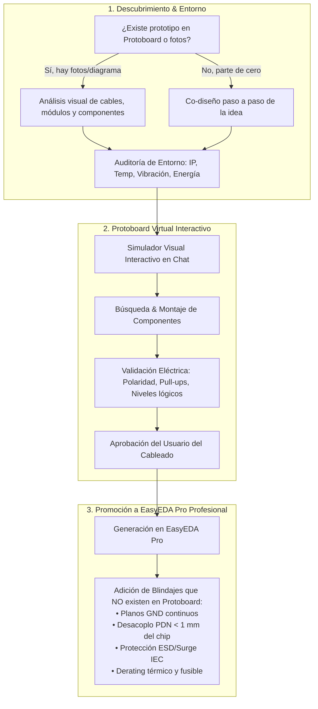

# Manual 13: Del Protoboard Físico y Virtual al PCB Profesional con Contexto de Entorno

## 1. Propósito y Filosofía del Co-Diseño

Este manual establece el estándar operativo para que el agente acompañe al usuario en la transición crítica entre la **idea preliminar montada en protoboard** (físico o simulado) y el **circuito impreso (PCB) industrial de alta confiabilidad**, integrando desde el primer segundo el **contexto ambiental, mecánico y de uso final**.

---

## 2. Protocolo de Indagación de Prototipo Físico y Fotos

Al inicio de cualquier interacción o en la **Fase 0**, el agente debe formular con claridad:

> **Pregunta Clave del Agente:**  
> *"¿Tienes ya este circuito armado en un protoboard físico, un boceto en papel o fotos del montaje?*  
> * *Si ya lo armaste:* Sube las fotos o lista de conexiones para que analice visualmente los pines, módulos y cables puente (*jumpers*). Generaré un **Protoboard Virtual Interactivo** para confirmar que entendí exactamente tu circuito.  
> * *Si partes de una idea:* Construiremos juntos el Protoboard Virtual paso a paso, buscando los componentes adecuados y probando el cableado antes de pasar al PCB."*

### 2.1. Reglas para Analizar Fotos de Protoboards Físicos
Cuando el usuario proporciona una foto o imagen del armado:
1. **Identificación de Módulos:** Localice primero los circuitos integrados, microcontroladores (ESP32, Arduino, Raspberry Pi Pico) y módulos comerciales (sensores, relevadores, pantallas).
2. **Trazado de Alimentación:** Siga los cables rojo y negro hacia los rieles laterales del protoboard; verifique si el protoboard tiene la **brecha central de alimentación** (muchos protoboards tienen los rieles laterales divididos en la mitad y requieren un puente).
3. **Detección de Riesgos Inmediatos en Foto:**
   * Cables de alimentación invertidos.
   * Ausencia de resistencia en serie con diodos LED.
   * Conexión directa de cargas inductivas (bobinas, motores, relés) a pines de MCU sin diodo volante (*flyback*) ni transistor de conmutación.
   * Módulos de 3.3 V (ej. ESP32, sensores I2C de precisión) conectados directamente a líneas de 5 V de un Arduino sin traslador de nivel lógico (*level shifter*).

---

## 3. Auditoría del Contexto de Operación y Condiciones Ambientales

Un circuito que funciona en la mesa del laboratorio puede fallar catastrophicamente en campo si no se diseña para su entorno real. El agente debe interrogar y registrar las siguientes 5 dimensiones en `ENVIRONMENT-CONDITIONS.md`:

| Dimensión Ambiental / Mecánica | Pregunta al Usuario | Requisito Normativo en el PCB |
| :--- | :--- | :--- |
| **1. Ubicación y Carcasa (*Enclosure*)** | ¿Operará en interiores (oficina/hogar) o intemperie/exterior (lluvia, polvo, radiación solar)? | Si es intemperie: exigir gabinete **IP65/IP67**, espacio perimetral de montaje $\ge 5\,\text{mm}$ y considerar barniz de tropicalizado (*Conformal Coating* según **IPC-CC-830**). |
| **2. Rango Térmico de Operación** | ¿Estará expuesto a frío extremo, calor de motor o ambiente controlado ($0\text{ a }40\,^\circ\text{C}$ vs. $-40\text{ a }+85\,^\circ\text{C}$)? | Selección de grado comercial ($0\text{ a }70\,^\circ\text{C}$), industrial ($-40\text{ a }+85\,^\circ\text{C}$) o automotriz **AEC-Q100** (hasta $+125\,^\circ\text{C}$). Derating térmico del $50\%$ en potencia. |
| **3. Vibración y Esfuerzo Mecánico** | ¿Irá montado en un vehículo, motor, bomba de agua o estructura con vibración continua? | Conectores con seguro de retención mecánica (JST-XH, Molex, terminales roscadas) en vez de pines headers sueltos; componentes pesados fijados con adhesivo RTV; cumplimiento **IEC 60068-2-6**. |
| **4. Naturaleza de la Fuente de Energía** | ¿Batería (Li-ion, LiPo, pilas), puerto USB, fuente conmutada comercial, o red vehicular ($12\text{--}24\,\text{V}$)? | En batería: diseñar etapas de *Deep Sleep* ($I_Q < 20\,\mu\text{A}$), corte por bajo voltaje (UVLO). En red vehicular: filtrado contra *Load Dump* (norma **ISO 16750-2** / **ISO 7637-2** con TVS de $600\text{--}1500\,\text{W}$). |
| **5. Longitud de Cables Externos (EMI/Surge)** | ¿Los sensores o pulsadores van soldados en la placa o tienen cables de más de $1\,\text{metro}$? | Todo cable $>30\,\text{cm}$ actúa como antena receptora de transitorios; exige diodo TVS dedicado (**IEC 61000-4-2**) y condensador cerámico de $10\text{--}100\,\text{nF}$ en la bornera de entrada. |

---

## 4. El Simulador de Protoboard Virtual Interactivo

El agente dispone de la capacidad de emitir un artefacto interactivo HTML5/SVG mediante **Generative UI** para visualizar el montaje antes de generar el PCB.

### 4.1. Características del Protoboard Virtual
1. **Lienzo Realista:** Matriz de conexión estándar de 830 puntos (filas 1 a 63, columnas a-e y f-j, canal central para chips DIP de $0.3''$, y buses dobles de alimentación superior e inferior).
2. **Biblioteca de Componentes Dinámica:**
   * Microcontroladores en formato breakout/placa de desarrollo: XIAO ESP32-C6 / ESP32-S3 / NodeMCU, Arduino Nano, Raspberry Pi Pico.
   * Periféricos habituales: Sensores I2C (BME280, SHT31, OLED SSD1306), sensores analógicos (LDR, potenciómetro), actuadores (relé con optoacoplador, servomotor, LED con resistencia limitadora).
3. **Código de Color Normalizado para Jumpers:**
   * **Rojo:** Alimentación positiva principal ($+5\,\text{V}$, $+3.3\,\text{V}$, $+V_{\text{BAT}}$).
   * **Negro:** Tierra de referencia común ($0\,\text{V}$ / $\text{GND}$).
   * **Amarillo / Naranja:** Señales digitales de control y PWM.
   * **Azul / Verde:** Buses de comunicación I2C (`SDA` verde, `SCL` azul) o UART (`TX` verde, `RX` azul).
   * **Blanco / Morado:** Entradas analógicas ADC.
4. **Inspección de Reglas en Vivo (*Pre-Flight Audit*):**
   * Alerta si dos cables de diferente potencial se cruzan en el mismo nodo (cortocircuito directo).
   * Alerta si un bus I2C no tiene resistencias de *pull-up* (típicamente $4.7\,\text{k}\Omega$).
   * Alerta de incompatibilidad lógica (conectar un pin GPIO de $3.3\,\text{V}$ a un actuador de $5\,\text{V}$ sin traslación de nivel).

---

## 5. El Salto Técnico: Del Protoboard al PCB Profesional

El agente debe explicar pedagógicamente al usuario por qué un circuito que funciona en protoboard **requiere adaptaciones obligatorias para convertirse en un PCB profesional**:

| Limitación Crítica del Protoboard | Solución Obligatoria en el PCB Profesional |
| :--- | :--- |
| **Capacitancia Parásita Elevada ($\approx 2\text{--}5\,\text{pF}$ entre columnas adyacentes)** | En el PCB se rutea con impedancia controlada (**IPC-2141A**), respetando la regla $3W$ para evitar diafonía en señales rápidas ($>1\,\text{MHz}$). |
| **Resistencia de Contacto Alta ($\approx 0.1\text{--}0.3\,\Omega$ por pinche)** | En el PCB las pistas de cobre de 1 oz reducen la resistencia a miliohmios y soportan corrientes de varios amperios calculadas bajo **IPC-2221**. |
| **Inductancia de Cables Puente ($L \approx 1\,\text{nH/mm}$)** | Los cables jumpers de $10\text{--}15\,\text{cm}$ introducen hasta $150\,\text{nH}$, deformando las conmutaciones. En el PCB los capacitores de desacoplo van a menos de $1\,\text{mm}$ del pin del IC sobre un plano GND de bajísima inductancia. |
| **Cero Protección contra ESD / Transitorios** | El protoboard no tiene diodos TVS ni planos de dispersión de carga; en el PCB se colocan supresores **IEC 61000-4-2** en cada conector de borde. |
| **Módulos de Desarrollo Voluminosos** | En el PCB se reemplaza el módulo de desarrollo completo por el chip autónomo montado en superficie (SMD) con su cristal oscilador y antena diseñada bajo norma, reduciendo costo y tamaño hasta un $80\%$. |

---

## 6. PCB de Conexión Interactivo, Política de Cero Invención y Creación en EasyEDA Pro

A partir de la versión **v4.2**, el flujo de prototipado se eleva a un **PCB de Conexión Interactivo** ([`templates/PCB-CONNECTION-WORKBENCH.template.html`](../templates/PCB-CONNECTION-WORKBENCH.template.html)) que combina obtención real de *pinouts*, posicionamiento físico 2D y simulación eléctrica con cálculos reales:

### 6.1. Regla de Bloqueo por Ficha Técnica (*Datasheet-First / Hard-Stop Gate*)
1. **Ningún equipo se dibuja ni se cablea por suposición:** Cada módulo, sensor, relé o conector debe registrar su fuente de ficha técnica (`datasheet_source`) y lista exacta de pines (`number`, `name`, `type`, `voltage_v`, `max_current_ma`, `tolerant_5v`).
2. **Si el agente tiene duda sobre un componente:**
   * Marca el equipo como `datasheet_verified: false` (**BLOQUEADO — SIN FICHA**).
   * **DETIENE el diseño** y solicita al usuario el PDF del datasheet, enlace oficial del fabricante, código LCSC o fotografía nítida de la serigrafía del módulo.
3. **Solo procede cuando entiende el 100 %:** La promoción hacia EasyEDA Pro permanece bloqueada hasta que `pcb_verify_connection_board` devuelva `status: "APPROVED_FOR_EASYEDA"` y el usuario apruebe la ubicación física de los componentes.

### 6.2. Posicionamiento Interactivo y Pipeline hacia EasyEDA Pro
1. **Posicionamiento en Lienzo Real (Drag & Drop):** El usuario y el agente ajustan las coordenadas $(X, Y)$ en milímetros y la rotación ($0^\circ/90^\circ/180^\circ/270^\circ$) de cada equipo sobre el contorno `BoardOutline`, verificando en vivo **0 colisiones de *courtyard***.
2. **Simulación Operativa con Valores Reales:** Se validan corrientes reales ($I = (V - V_f)/R$), potencias ($P = I^2 R$), niveles lógicos y ancho mínimo **IPC-2221** antes de tocar el CAD.
3. **Ejecución Transaccional en EasyEDA Pro:**
   * `pcb_verify_connection_board` (en `agent-design-pcb`) $\rightarrow$ genera `easyeda_integration_pipeline` y las coordenadas exactas en **mils**.
   * `easyeda_project_begin_transaction` $\rightarrow$ `easyeda_catalog_verify_device` $\rightarrow$ `easyeda_schematic_place_component` + `easyeda_schematic_connect_pins_by_net`.
   * `easyeda_erc_run` (0 errores) $\rightarrow$ `easyeda_schematic_sync_to_pcb` $\rightarrow$ `easyeda_pcb_place_batch` (aplicando el posicionamiento exacto del PCB de Conexión).
   * Ruteo normativo, reconstrucción de planos GND (`Shift+B`) y `easyeda_drc_run` (0 errores).
