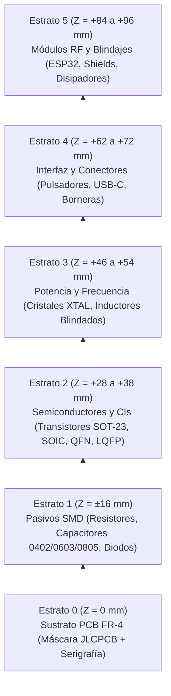

# Manual 15: Visualización 3D Industrial, Knolling y Gemelos Digitales de Hardware

> **Propósito:** Definir los estándares de ingeniería y las directrices cinemáticas para la generación de Gemelos Digitales 3D, vistas explosionadas ortogonales en el eje Z, planos simétricos de Knolling (Flat-Lay de laboratorio) y simulaciones de línea de montaje SMT, acoplados nativamente a los modelos 3D y componentes reales de **EasyEDA Pro** y **JLCPCB**.  
> **Estándares aplicados:** ISO 24495-1 (Lenguaje Claro), ISO/IEC 82079-1, IPC-7351B (*Generic Requirements for Surface Mount Design and Land Pattern Standard*), IPC-2221C, IEC 61188-7 (*Zero-orientation of components*).  
> **Autor:** S&D MMCALL — Proyecto Comunitario `AGENT-DESIGN-PCB`.

---

## 1. Fundamentos del Gemelo Digital en Hardware Electrónico

En la ingeniería de hardware profesional, la visualización tridimensional **no es un adorno cosmético**. Es un instrumento crítico de validación física, revisión de ensamblabilidad (DFA - *Design for Assembly*) y aseguramiento de calidad pre-fabricación:

| Desafío en Diseño Físico 2D | Cómo lo Resuelve el Gemelo Digital 3D | Herramienta Acoplada en el Ecosistema |
| :--- | :--- | :--- |
| **Colisiones Mecánicas con Carcasas y Tornillos** | Permite verificar en tiempo real las alturas máximas de conectores, inductores y capacitores contra la envolvente (*enclosure*) antes de fresar o imprimir en 3D. | `pcb_generate_3d_showcase` $\rightarrow$ Exportación FreeCAD / STEP (`PCB_ManufactureData.get3DFile`). |
| **Errores de Polaridad y Orientación de Pin 1** | El 32 % de los fallos de montaje SMT manual y prototipado rápido ocurren por diodos, CI o capacitores de tántalo invertidos. La vista 3D exhibe claramente los chaflanes, puntos de pin 1 y bandas de cátodo. | Inspección de Serigrafía 3D y Rayos Guía de Ensamble (*Assembly Rays*). |
| **Auditoría de Courtyard y Soldabilidad (IPC-7351B)** | Evita que el cuerpo físico de un conector USB o bobina de potencia impida el descenso de la tobera de la máquina *Pick & Place* o la sombra térmica durante el horno de reflujo. | `easyeda_floorplan_verifier` + `pcb_generate_3d_showcase`. |
| **Documentación Técnica de Ensamble y Manuales** | Genera planos explosionados comprensibles para técnicos de planta y clientes finales sin necesidad de que abran un software CAD complejo. | Visualizador interactivo HTML5 WebGL / Three.js. |

---

## 2. Arquitectura de la Vista Explosionada en el Eje Z

La Vista Explosionada desacopla los componentes verticalmente para permitir una inspección visual sin oclusiones. Para mantener el rigor técnico, la separación sigue una **jerarquía estricta por estratos de ensamble**:

### Reglas Normativas para la Explosión:
1. **Diferenciación de Capas (Top vs. Bottom):**
   * Los componentes de la cara superior (*Top Layer*) se elevan en dirección $+Z$.
   * Los componentes de la cara inferior (*Bottom Layer*) descienden en dirección $-Z$ manteniendo su rotación física invertida de $180^\circ$ sobre el eje X.
2. **Rayos Guía de Ensamble (*Assembly Rays*):**
   * Cada componente mantiene un vector de guiado punteado que une su centroide 3D flotante con el centro geométrico de sus pads sobre el sustrato PCB.
   * Si el factor de explosión es $0.0$, el rayo colapsa a longitud cero (placa ensamblada plana). Con factor $1.0$, el rayo exhibe la trayectoria de descenso exacta que seguirá la boquilla SMT.

---

## 3. El Arte y el Rigor del Knolling (Flat-Lay Cenital Simétrico)

El término **Knolling** describe el proceso de disponer componentes u objetos relacionados en ángulos exactos de $90^\circ$ sobre una superficie plana, organizados de forma simétrica por tamaño, familia o secuencia de ensamble:

1. **Ancla Visual Central / Izquierda:** El sustrato PCB desprovisto de componentes se ubica como referencia principal.
2. **Cuadrícula Ortogonal de Componentes:** Los dispositivos se agrupan por familias (Semiconductores, Pasivos, Electromecánicos, Conectores) en celdas cuadradas con espaciado constante ($P \ge 6\text{--}8\,\text{mm}$).
3. **Placas de Identificación Serigráfica:** Cada grupo cuenta con una etiqueta en el suelo con Designador (ej. `U1`), Part Number y LCSC Part ID para facilitar la compra y el control de inventario previo a producción.
4. **Perspectiva de Cámara:** Proyección ortográfica cenital a $90^\circ$ desde el eje vertical Y/Z.

---

## 4. Animación Cinemática de Ensamble (Línea de Montaje Virtual)

Para presentaciones ejecutivas, ferias tecnológicas y validación de clientes, la herramienta genera curvas de interpolación continua mediante funciones **Hermite Smoothstep**:

$$S(u) = 3u^2 - 2u^3 \quad \text{donde } u \in [0, 1]$$

El ciclo cinemático se divide en 5 etapas secuenciales:
- **0 a 15%:** Pausa y contemplación de piezas en modo Knolling (*Flat-Lay*).
- **15 a 40%:** Vuelo orbital de las piezas hacia sus posiciones explosionadas en el eje Z sobre sus respectivos pads.
- **40 a 65%:** Descenso progresivo y simulación de soldadura en horno de reflujo por capas (Bottom $\to$ Pasivos Top $\to$ CIs $\to$ Conectores THT).
- **65 a 90%:** Inspección de calidad 360° con giro orbital de la cámara sobre el producto ensamblado.
- **90 a 100%:** Apertura suave en bucle continuo hacia la siguiente iteración.
